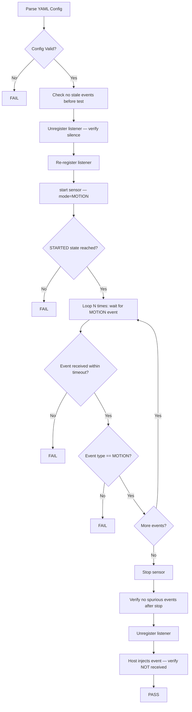
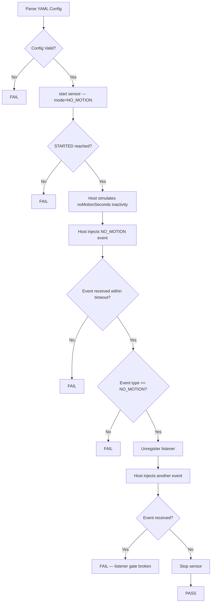
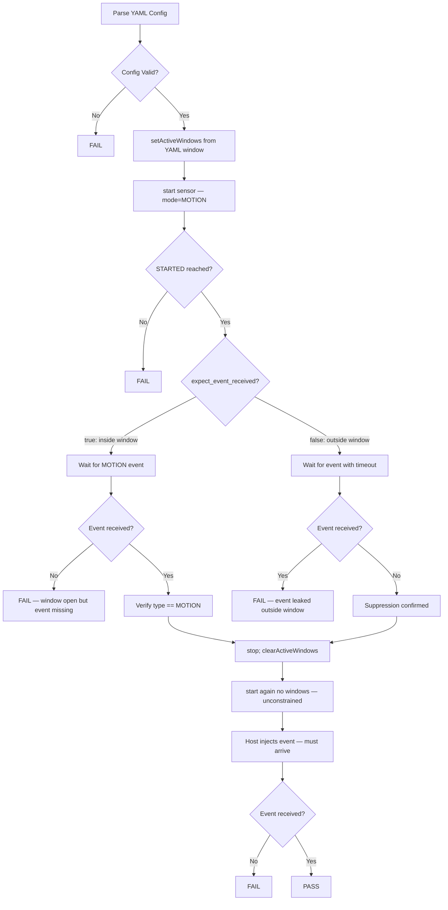

# Motion Sensor HAL L3 Low Level Test Specification

## Table of Contents

* [Scope](#scope)
* [References](#references)
* [Acronyms, Terms and Abbreviations](#acronyms-terms-and-abbreviations)
* [Level 3 Test Procedure](#level-3-test-procedure)
* [Level 3 Test Cases Overview](#level-3-test-cases-overview)
* [Test Case Details](#test-case-details)
  * [Test 1: MotionEventDetection](#test-1-motioneventdetection)
  * [Test 2: NoMotionEventDetection](#test-2-nomotioneventdetection)
  * [Test 3: ActiveWindowBehavior](#test-3-activewindowbehavior)
  * [Test 4: DeepSleepAutonomy](#test-4-deepsleepautonomy)

---

## Scope

This document describes the Level 3 (L3) Low-Level Test Specification for the Motion Sensor HAL.

L3 testing validates end-to-end Motion Sensor HAL functionality using real device operations with control-plane event injection. The test suite exercises:

* Motion event delivery with listener gating validation
* No-motion (inactivity) event delivery with configurable timeout
* Active time-window event suppression and gating
* Deep sleep autonomy — motion detection while the SoC is in a low-power sleep state

L3 tests require external stimulus injected by the Python host via the UT control plane. The DUT-side VTS binary starts the sensor, waits for events, and validates results; the Python host is responsible for triggering events via the control port (physical or virtual).

---

## Acronyms, Terms and Abbreviations

- `HAL`    - Hardware Abstraction Layer
- `VTS`    - Vendor Test Suite
- `L1`     - Level 1 Testing
- `L2`     - Level 2 Testing
- `L3`     - Level 3 Testing
- `DUT`    - Device Under Test
- `RAFT`   - Rapid Automation Framework for Testing
- `YAML`   - YAML Ain't Markup Language
- `AIDL`   - Android Interface Definition Language
- `PIR`    - Passive Infrared (sensor type)
- `HFP`    - Hardware Feature Profile

---

## References

- High Level Test Specification — [motion_sensor_High_Level_TestSpecification.md](motion_sensor_High_Level_TestSpecification.md)
- L2 Test Specification — [motion_sensor_L2_Low-Level_TestSpecification.md](motion_sensor_L2_Low-Level_TestSpecification.md)
- L3 YAML Configuration — [test_configuration/vts_l3_MotionSensor.yaml](../../test_configuration/vts_l3_MotionSensor.yaml)
- HFP Profile — [profiles/hfp-motionsensor.yaml](../../profiles/hfp-motionsensor.yaml)
- Motion Sensor AIDL Interfaces:
  - [IMotionSensorManager](https://github.com/rdkcentral/rdk-halif-aidl/blob/main/sensor/current/com/rdk/hal/sensor/motion/IMotionSensorManager.aidl)
  - [IMotionSensor](https://github.com/rdkcentral/rdk-halif-aidl/blob/main/sensor/current/com/rdk/hal/sensor/motion/IMotionSensor.aidl)
  - [IMotionSensorController](https://github.com/rdkcentral/rdk-halif-aidl/blob/main/sensor/current/com/rdk/hal/sensor/motion/IMotionSensorController.aidl)
  - [IMotionSensorControllerListener](https://github.com/rdkcentral/rdk-halif-aidl/blob/main/sensor/current/com/rdk/hal/sensor/motion/IMotionSensorControllerListener.aidl)
  - [IMotionSensorEventListener](https://github.com/rdkcentral/rdk-halif-aidl/blob/main/sensor/current/com/rdk/hal/sensor/motion/IMotionSensorEventListener.aidl)


---

## Level 3 Test Procedure

The L3 Motion Sensor test suite operates as follows:

1. Python host reads the YAML test configuration and updates fields (e.g., `sensor_index`, `num_events`, window times).
2. Python host uploads the updated YAML to the DUT target directory.
3. Python host starts the DUT-side VTS binary via SSH (or triggers it within the RAFT framework).
4. DUT-side VTS parses the YAML, performs the test steps, and waits for events.
5. Python host injects synthetic events via the UT control port (or monitors real hardware).
6. DUT-side VTS validates received events and reports pass/fail.
7. Python host collects the result and logs it.

---

## Level 3 Test Cases Overview

| # | Test Case | Description | HAL APIs |
|---|-----------|-------------|----------|
| 1 | `MotionEventDetection` | Validate MOTION mode event delivery, listener gating, and absence of spurious events | `IMotionSensorController::start()`, `IMotionSensor::registerEventListener()`, `IMotionSensorEventListener::onEvent()`, `IMotionSensorController::stop()` |
| 2 | `NoMotionEventDetection` | Validate NO_MOTION mode event delivery after `noMotionSeconds` of inactivity | `IMotionSensorController::start()`, `IMotionSensor::registerEventListener()`, `IMotionSensorEventListener::onEvent()`, `IMotionSensorController::stop()` |
| 3 | `ActiveWindowBehavior` | Validate time-window gating — events received inside window, suppressed outside | `IMotionSensorController::setActiveWindows()`, `IMotionSensorController::clearActiveWindows()`, `IMotionSensorController::start()`, `IMotionSensorEventListener::onEvent()` |
| 4 | `DeepSleepAutonomy` | Validate event delivery during deep sleep when autonomy is enabled vs. disabled | `IMotionSensorController::setAutonomousDuringDeepSleep()`, `IMotionSensor::getCapabilities()`, `IMotionSensorController::start()`, `IMotionSensorEventListener::onEvent()` |

---

## Test Case Details

---

## Test 1: MotionEventDetection

| Title | Details |
| ----- | ------- |
| Function Name | `MotionEventDetection` |
| Description | Validates MOTION mode event delivery, listener registration/unregistration gating, and the absence of spurious or stale events before, during, and after the test |
| Test Group | 03 |
| Test Case ID | 001 |
| Priority | High |

### Pre-Conditions

* Motion Sensor HAL service must be running.
* The HAL service must be running with the control plane enabled.
* YAML configuration must be present at the path defined by `VTS_MOTIONSENSOR_TEST_CONFIG_PATH`.
* [test_configuration/vts_l3_MotionSensor.yaml](../../test_configuration/vts_l3_MotionSensor.yaml) must have `MotionEventDetection` section populated.

### Dependencies

* Motion Sensor HAL Interfaces: `IMotionSensor`, `IMotionSensorController`, `IMotionSensorEventListener`
* Python host test: `vts_motionsensor_L3_MotionEventDetection.py`
* UT control plane for event injection

### User Interaction

No

---

### Test Flow Diagram



---

### Test Procedure

| Step | Description | Test Data | Expected Result |
| ---- | ----------- | --------- | --------------- |
| 1 | Parse YAML configuration for `MotionEventDetection` | `vts_l3_MotionSensor.yaml` | Config parsed successfully |
| 2 | Drain any stale events from the event queue | 200 ms drain window | No stale events received |
| 3 | Unregister event listener; confirm silence | 500 ms window | No events received |
| 4 | Re-register event listener | Valid `IMotionSensorEventListener` | Registration succeeds |
| 5 | Call `start(config)` with `mode=MOTION` | `StartConfig{MOTION, noMotionSeconds=0}` | Start succeeds without exception |
| 6 | Wait for STARTED state via `onStateChanged` | State queue | State transitions to `STARTED` |
| 7 | Repeat N times: wait for MOTION event from host injection | `eventTimeoutMs` from YAML | Event received; type is `MOTION` |
| 8 | Call `stop()` | — | Stop succeeds |
| 9 | Drain queue; verify no post-stop spurious events | 500 ms window | No events received after stop |
| 10 | Unregister listener; host injects event | 2000 ms window | Event NOT received — listener gating confirmed |

---

### YAML Configuration Fields

```yaml
motionsensor:
  L3:
    MotionEventDetection:
      sensor_index: 0
      operational_mode: "MOTION"
      no_motion_seconds: 0
      active_start_seconds: 0
      active_stop_seconds: 0
      event_timeout_ms: 15000
      num_events: 3
```

---

## Test 2: NoMotionEventDetection

| Title | Details |
| ----- | ------- |
| Function Name | `NoMotionEventDetection` |
| Description | Validates that the HAL fires an `onEvent(NO_MOTION)` callback after `noMotionSeconds` of continuous inactivity, and that no events are delivered after listener unregistration |
| Test Group | 03 |
| Test Case ID | 002 |
| Priority | High |

### Pre-Conditions

* Motion Sensor HAL service must be running.
* The HAL service must be running with the control plane enabled.
* [test_configuration/vts_l3_MotionSensor.yaml](../../test_configuration/vts_l3_MotionSensor.yaml) must have `NoMotionEventDetection` section populated.

### Dependencies

* Motion Sensor HAL Interfaces: `IMotionSensor`, `IMotionSensorController`, `IMotionSensorEventListener`
* Python host test: `vts_motionsensor_L3_NoMotionEventDetection.py`
* UT control plane for inactivity simulation and event injection

### User Interaction

No

---

### Test Flow Diagram



---

### Test Procedure

| Step | Description | Test Data | Expected Result |
| ---- | ----------- | --------- | --------------- |
| 1 | Parse YAML for `NoMotionEventDetection` | `vts_l3_MotionSensor.yaml` | Config parsed successfully |
| 2 | Call `start(config)` with `mode=NO_MOTION` | `StartConfig{NO_MOTION, noMotionSeconds=5}` | Start succeeds |
| 3 | Wait for STARTED state | State queue | State is `STARTED` |
| 4 | Host simulates `noMotionSeconds` of inactivity, then injects `NO_MOTION` event | `noMotionSeconds` from YAML | Host-side command sent to HAL service |
| 5 | Wait for `onEvent` callback | `eventTimeoutMs` from YAML | Event received |
| 6 | Verify event type | Received mode | `OperationalMode::NO_MOTION` |
| 7 | Unregister listener; host injects additional event | 2000 ms window | Event NOT received |
| 8 | Re-register listener for clean teardown | — | Registration succeeds |
| 9 | Stop sensor | — | Stop succeeds; state returns to `STOPPED` |

---

### YAML Configuration Fields

```yaml
motionsensor:
  L3:
    NoMotionEventDetection:
      sensor_index: 0
      operational_mode: "NO_MOTION"
      no_motion_seconds: 5
      active_start_seconds: 0
      active_stop_seconds: 0
      event_timeout_ms: 30000
      num_events: 3
```

---

## Test 3: ActiveWindowBehavior

| Title | Details |
| ----- | ------- |
| Function Name | `ActiveWindowBehavior` |
| Description | Validates that active time windows gate event emission correctly. Events are delivered when the current time is inside a configured window and suppressed when outside. Also validates that clearing all windows restores 24-hour monitoring. |
| Test Group | 03 |
| Test Case ID | 003 |
| Priority | High |

### Pre-Conditions

* Motion Sensor HAL service must be running.
* The HAL service must be running with the control plane enabled.
* [test_configuration/vts_l3_MotionSensor.yaml](../../test_configuration/vts_l3_MotionSensor.yaml) must have `ActiveWindowBehavior` section populated.
* Python host will iterate multiple window scenarios (positive/suppression) and update YAML fields before each iteration.

### Dependencies

* Motion Sensor HAL Interfaces: `IMotionSensor`, `IMotionSensorController`, `IMotionSensorEventListener`
* Python host test: `vts_motionsensor_L3_ActiveWindowBehavior.py`
* UT control plane for event injection

### User Interaction

No

---

### Test Flow Diagram



---

### Test Procedure

| Step | Description | Test Data | Expected Result |
| ---- | ----------- | --------- | --------------- |
| 1 | Parse YAML for `ActiveWindowBehavior` (window times, `expect_event_received`) | `vts_l3_MotionSensor.yaml` | Config parsed |
| 2 | Call `setActiveWindows([{start, end}])` in STOPPED state | Window from YAML | Returns `true` |
| 3 | Call `getActiveWindows()` and verify returned window matches | — | Matches configured window |
| 4 | Call `start(config)` with `mode=MOTION` | `StartConfig{MOTION}` | Start succeeds |
| 5 | Wait for STARTED state | State queue | State is `STARTED` |
| 6a *(if `expect_event_received=1`)* | Host injects MOTION event; wait for `onEvent` | `eventTimeoutMs` | Event received; type is `MOTION` |
| 6b *(if `expect_event_received=0`)* | Host injects MOTION event; wait for `onEvent` | `eventTimeoutMs` | Timeout — event suppressed |
| 7 | Stop sensor | — | Stop succeeds |
| 8 | Call `clearActiveWindows()` | — | Returns `true` |
| 9 | Verify `getActiveWindows()` returns empty array | — | Empty array returned |
| 10 | Start sensor again with no windows | `StartConfig{MOTION}` | Start succeeds |
| 11 | Host injects MOTION event; verify event arrives | `eventTimeoutMs` | Event received — 24h monitoring confirmed |
| 12 | Stop sensor | — | Stop succeeds |

---

### Active Window Test Scenarios (Iterated by Python Host)

| # | Scenario | Dynamic | `expect_event` | Notes |
|---|----------|---------|----------------|-------|
| 1 | Full-day window `[00:00, 23:59:59]` | No | `true` | Always contains any time |
| 2 | 2-hour window centred on current time `[now−1h, now+1h]` | Yes | `true` | |
| 3 | 10-minute window centred on current time `[now−5m, now+5m]` | Yes | `true` | |
| 4 | 8-hour window centred on current time `[now−4h, now+4h]` | Yes | `true` | |
| 5 | Midnight-spanning window `[22:00, 02:00]` | No | `true` | Skipped if current time outside window |
| 6 | Window not yet open (opens 30 s from now) | Yes | `false` | Suppressed during 15 s test timeout |
| 7 | Window already closed (ended 30 s ago) | Yes | `false` | |
| 8 | Window 12 hours in the future | No | `false` | |
| 9 | Zero-length window `[same, same]` | No | `false` | Degenerate case |
| 10 | Inverted window `[now+1h, now−1h]` | Yes | `false` | End before start, no wraparound |

---

### YAML Configuration Fields

```yaml
motionsensor:
  L3:
    ActiveWindowBehavior:
      sensor_index: 0
      window_start_seconds: 0      # overwritten by Python per iteration
      window_end_seconds: 86399    # overwritten by Python per iteration
      expect_event_received: 1     # overwritten by Python per iteration (1 or 0)
      event_timeout_ms: 15000
      trigger_interval_seconds: 3
```

---