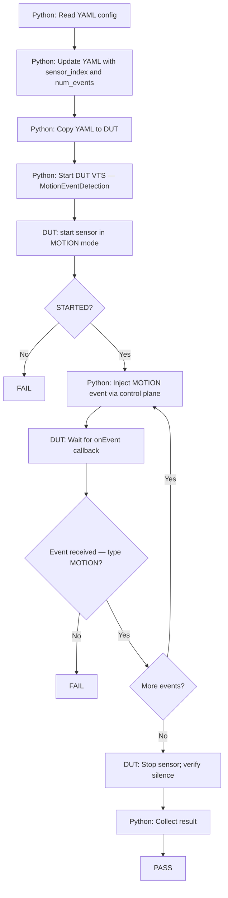
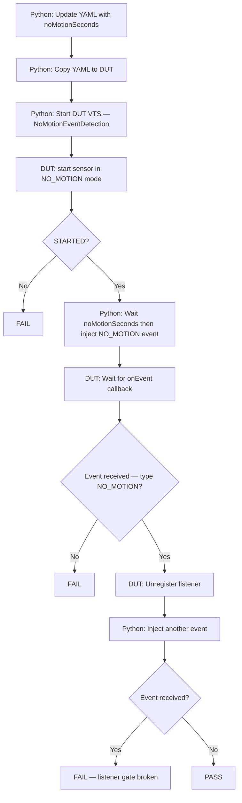
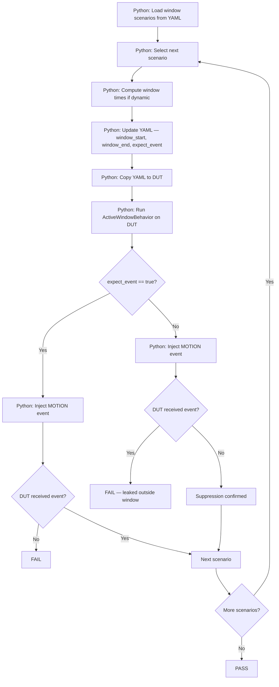
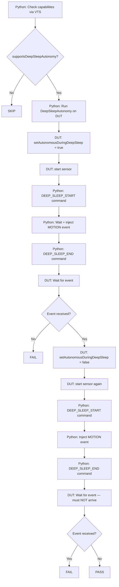

# Motion Sensor HAL L1, L2, L3 Test Procedure

## Table of Contents

* [Acronyms, Terms and Abbreviations](#acronyms-terms-and-abbreviations)
* [Build the VTS](#build-the-vts)
  * [Build Linux Binder](#build-linux-binder)
  * [Build Motion Sensor VTS](#build-motion-sensor-vts-binaries)
  * [Environment Variables](#environment-variables)
  * [Build](#build)
* [Run L1 L2 Tests Without Python](#run-l1-l2-tests-without-python)
  * [Transfer Tar File to Target Device](#transfer-tar-file-to-target-device)
  * [Extract on Target Device](#extract-on-target-device)
  * [Run the VTS Test on Target Device](#run-the-vts-test-on-target-device)
* [Run Tests in Python Environment](#run-tests-in-python-environment)
  * [Update Configuration Files](#update-configuration-files)
  * [Install Python Packages](#install-python-packages)
  * [Run Test Cases](#run-test-cases)
* [L3 Test Cases](#l3-test-cases)
  * [L3 Test 1 — MotionEventDetection](#l3-test-1--motioneventdetection)
  * [L3 Test 2 — NoMotionEventDetection](#l3-test-2--nomotioneventdetection)
  * [L3 Test 3 — ActiveWindowBehavior](#l3-test-3--activewindowbehavior)
  * [L3 Test 4 — DeepSleepAutonomy](#l3-test-4--deepsleepautonomy)
* [Notes](#notes)

---

## Acronyms, Terms and Abbreviations

* `HAL`   - Hardware Abstraction Layer
* `VTS`   - Vendor Test Suite
* `L1`    - Level 1 Testing
* `L2`    - Level 2 Testing
* `L3`    - Level 3 Testing
* `DUT`   - Device Under Test
* `RAFT`  - Rapid Automation Framework for Testing
* `YAML`  - YAML Ain't Markup Language
* `AIDL`  - Android Interface Definition Language
* `PIR`   - Passive Infrared (sensor type)
* `HFP`   - Hardware Feature Profile
* `SSH`   - Secure Shell

---

## Build the VTS

### Build Linux Binder

The test suite depends on Linux binder with `AIDL` support.

For detailed instructions, refer to: [Linux Binder](https://github.com/rdkcentral/linux_binder_idl/tree/1.0.0)

```bash
git clone -b develop 'https://github.com/rdkcentral/linux_binder_idl.git'
cd linux_binder_idl
./build-linux-binder-aidl.sh 64
```

---

### Build Motion Sensor VTS Binaries

Clone and build the Motion Sensor test suite:

```bash
git clone git@github.com:rdkcentral/rdk-halif-aidl-test-motion-sensor.git
cd rdk-halif-aidl-test-motion-sensor
```

---

### Environment Variables

Set environment variables:

- `AIDL_BIN`: Path to the AIDL compiler.
- `LINUX_BINDER_OUT_DIR`: Path to Linux binder output directory.
- `UT_CORE_VERSION`: UT-Core version (optional; defaults to latest tag).
- `RDK_HALIF_AIDL_VERSION`: AIDL HAL spec version (optional; defaults to latest HEAD).
- `VCOMPONENT_MOTIONSENSOR_VERSION`: Motion Sensor vComponent version (if applicable in your setup).


Example:

```bash
export UT_CORE_VERSION=5.0.0
export RDK_HALIF_AIDL_VERSION=0.15.0
export VCOMPONENT_MOTIONSENSOR_VERSION=0.1.0
export AIDL_BIN=/path/to/linux_binder_idl/out/aidl
export LINUX_BINDER_OUT_DIR=/path/to/linux_binder_idl/local/
```

Enable UT logs (optional):

```bash
export ENABLE_UT_INFO_LOGGING=1
```

---

### Build

```bash
./build.sh Target=<Target-name>

# Supported Targets: linux, arm
```

Build output:
- Binaries under `build/bin/`
- Tarball `vts-motionsensor.tar.gz` under `build/bin/`

---

## Run L1 L2 Tests Without Python

### Transfer Tar File to Target Device

```bash
scp -P <port> build/bin/vts-motionsensor.tar.gz root@<DUT>:/tmp/
```

### Extract on Target Device

```bash
ssh root@<DUT>
mkdir -p /tmp/motionsensor
tar -zxf /tmp/vts-motionsensor.tar.gz -C /tmp/motionsensor
cd /tmp/motionsensor
```

### Run the VTS Test on Target Device

```bash
./run.sh -p profiles/hfp-motionsensor-vcomponent.yaml
```

---

## Run Tests in Python Environment

### Update Configuration Files

#### Rack Configuration File

Example: [host/configs/vts_rack_configuration.yaml](../../host/configs/vts_rack_configuration.yaml)

Update the console sessions and `motionSensorController` block for your test setup.

| Console Session | Description |
|----------------|-------------|
| `default` | Device status and basic operations |
| `ssh_hal_test` | Executes Motion Sensor HAL VTS binary on DUT |
| `ssh_hal_test_1` | Second SSH session for vComponent control |

```yaml
rackConfig:
  rack1:
    name: "rack1"
    slot1:
      name: "slot1"
      devices:
        - dut:
            ip: ""
            platform: "vDevice"
            consoles:
              - default:
                  type: "ssh"
                  port: 5522
                  username: "root"
                  ip: ""
                  password: ""
                  prompt: "~#"
              - ssh_hal_test:
                  type: "ssh"
                  port: 5522
                  username: "root"
                  ip: ""
                  password: ""
                  prompt: "~#"
              - ssh_hal_test_1:
                  type: "ssh"
                  port: 5522
                  username: "root"
                  ip: ""
                  password: ""
                  prompt: "~#"
            motionSensorController:
                type: virtual-motionsensor-client
                vendor: "vComponent"
                address: "127.0.0.1"
                username: ""
                password: ''
                port: 5522
                control_port: 8080
            outbound:
              download_url: "tftp://tftp-server.com/rack1/slot1/"
              upload_url: "sftp://server-address/home/workspace/tftp/rack1/slot1/"
              workspaceDirectory: "./logs/workspace"
```

> **motionSensorController:** Configure this field according to your test platform. For physical hardware testing, use `manual-motionsensor-client` as `RAFT` doesn't support a motion sensor controller device. For virtual device testing, use `virtual-motionsensor-client`. For virtual device testing, provide the connection details of the device running vComponent.
- `control_port` - The port number where vComponent accepts command requests.

---

#### Device Configuration File

Example: [host/configs/vts_device_configuration.yaml](../../host/configs/vts_device_configuration.yaml)

```yaml
deviceConfig:
  cpe1:
    platform: "vDevice"
    model: "VTV"
    soc_vendor: "intel"
    target_directory: "/tmp/"
    motionsensor_process_name: "Vendor-MotionSensor"
    prompt: "~#"
    wait_time: 240
    test:
      profile: "../../profiles/hfp-motionsensor-vcomponent.yaml"
      controller_port: 8080
```

---

### Install Python Packages

From `host/`:

```bash
./install.sh
source activate_venv.sh
./install.sh
```

---

### Run Test Cases

#### L1 and L2 Tests

```bash
python host/tests/vts_motionsensor_L1_L2_tests.py \
  --config </PATH>/host/configs/vts_rack_configuration.yaml \
  --deviceConfig </PATH>/host/configs/vts_device_configuration.yaml
```

---

#### L3 Tests

```bash
python host/tests/<L3-test-case>.py \
  --config </PATH>/host/configs/vts_rack_configuration.yaml \
  --deviceConfig host/configs/vts_device_configuration.yaml
```

##### Device Setup

###### vDevice

For vDevice, no external hardware needs to be connected to the setup.

###### Real Device

For real hardware, Place the device on a stable surface with the motion sensors enabled and accessible for stimulation. As the `RAFT` doesn't support automation of triggering motion simulator, Control the device manually

---

## L3 Test Cases

### L3 Test 1 — MotionEventDetection

#### Purpose

Validates MOTION mode event delivery end-to-end: from sensor start through event arrival, listener gating, and absence of spurious events after stop.

---

#### Test Flow



---

#### Test Steps (Python Host Side)

1. Read and update `vts_l3_MotionSensor.yaml` (`sensor_index`, `num_events`).
2. Upload updated YAML to DUT target directory.
3. Execute `MotionEventDetection` test case on DUT via SSH.
4. For each expected event: inject a MOTION event via the vComponent control port.
5. Collect DUT output and validate pass/fail result.

---

#### Expected Results

| Condition | Expected |
|-----------|----------|
| Sensor starts in MOTION mode | State reaches `STARTED` |
| `num_events` motion events injected | All `num_events` received with type `MOTION` |
| Post-stop event injection | No event received (silence confirmed) |
| Post-unregister event injection | No event received (listener gate confirmed) |

---

### L3 Test 2 — NoMotionEventDetection

#### Purpose

Validates `NO_MOTION` mode: the HAL fires `onEvent(NO_MOTION)` only after the configured `noMotionSeconds` of continuous inactivity. Verifies listener gating on unregistration.

---

#### Test Flow



---

#### Test Steps (Python Host Side)

1. Update `vts_l3_MotionSensor.yaml` with `noMotionSeconds` and `event_timeout_ms`.
2. Upload YAML to DUT.
3. Execute `NoMotionEventDetection` on DUT.
4. Wait `noMotionSeconds`, then inject a `NO_MOTION` event via control port.
5. After DUT unregisters listener, inject one additional event.
6. Validate DUT reports the first event received and the second event was suppressed.

---

#### Expected Results

| Condition | Expected |
|-----------|----------|
| After `noMotionSeconds` inactivity | `onEvent(NO_MOTION)` fired exactly once |
| After listener unregistration | No events delivered |

---

### L3 Test 3 — ActiveWindowBehavior

#### Purpose

Validates time-based active window gating across 10 scenarios: positive cases (event inside window), suppression cases (event outside window), and 24-hour monitoring after window clearance.

---

#### Test Flow



---

#### Test Steps (Python Host Side)

1. Load scenario list from `active_windows` in YAML configuration.
2. For each scenario:
   a. Compute `window_start_seconds` and `window_end_seconds` (apply dynamic offsets if applicable).
   b. Set `expect_event_received` based on scenario's `expect_event` flag.
   c. Update and upload YAML to DUT.
   d. Execute `ActiveWindowBehavior` on DUT.
   e. Inject MOTION event via control port; collect pass/fail.
3. After all window scenarios, execute unconstrained (no-window) phase and validate event delivery.

---

#### Expected Results

| Scenario Category | Expected |
|-------------------|----------|
| Positive (window contains current time) | Event received |
| Suppression (window excludes current time) | No event received (timeout) |
| After `clearActiveWindows()` | Event received in unconstrained mode |

---

### L3 Test 4 — DeepSleepAutonomy

#### Purpose

Validates that when `setAutonomousDuringDeepSleep(true)` is set, motion events are delivered during simulated deep sleep. Conversely, when disabled, events are suppressed during sleep.

---

#### Test Flow



---

#### Test Steps (Python Host Side)

1. Query DUT capabilities to determine `supportsDeepSleepAutonomy`; skip if `false`.
2. Execute `DeepSleepAutonomy` on DUT.
3. **Phase 1 (autonomy enabled):**
   a. Send `DEEP_SLEEP_START` command to vComponent.
   b. Wait `deepSleepDurationSeconds`.
   c. Inject a MOTION event via control port.
   d. Send `DEEP_SLEEP_END` command.
   e. Validate DUT received the event.
4. **Phase 2 (autonomy disabled):**
   a. Send `DEEP_SLEEP_START` command.
   b. Inject a MOTION event.
   c. Send `DEEP_SLEEP_END` command.
   d. Validate DUT did NOT receive the event.

---

#### Expected Results

| Phase | Condition | Expected |
|-------|-----------|----------|
| Autonomy enabled | MOTION event injected during sleep | Event received after wake |
| Autonomy disabled | MOTION event injected during sleep | Event NOT received |

---

## Notes

### vComponent Mode

When testing with the vComponent, events are injected synthetically via the control plane (HTTP port `8080` by default). The vComponent simulates sensor hardware including:

- Motion detection events (`MOTION` and `NO_MOTION`)
- Active window transitions (`onActiveWindowEntered`, `onActiveWindowExited`)
- Deep sleep simulation (`DEEP_SLEEP_START` / `DEEP_SLEEP_END`)

No physical sensor or motion stimulus is required.

---

### Actual Hardware Mode

For real hardware testing:

- Replace the `motionSensorController` block in the rack config with the appropriate physical hardware controller type.
- Ensure the physical sensor is correctly wired and accessible.
- L3 event injection steps require a physical mechanism to trigger (or suppress) motion events during the test window (e.g., a controllable IR light source for PIR sensors, or a motorized actuator).

---

### Hardware Feature Profile (HFP)

The HFP file [profiles/hfp-motionsensor-vcomponent.yaml](../../profiles/hfp-motionsensor-vcomponent.yaml) defines platform-specific sensor capabilities:

```yaml
sensor:
  motion:
    - id: 0
      sensorName: "PIR-Front-1"
      sensitivity_range:
        minSensitivity: 1
        maxSensitivity: 10
      supportsDeepSleepAutonomy: true
      operational_modes:
        - MOTION
        - NO_MOTION
      defaultStartConfig:
        operationalMode: MOTION
        noMotionSeconds: 5
        activeStartSeconds: 0
        activeStopSeconds: 0
      active_windows:
        - startTimeOfDaySeconds: 32400   # 09:00:00
          endTimeOfDaySeconds: 61200     # 17:00:00
        - startTimeOfDaySeconds: 72000   # 20:00:00
          endTimeOfDaySeconds: 79200     # 22:00:00
```

Update this file to match your platform's actual sensor capabilities before running any tests.

---

### L3 Test Configuration File

[test_configuration/vts_l3_MotionSensor.yaml](../../test_configuration/vts_l3_MotionSensor.yaml)

This file is updated dynamically by the Python host before each L3 test run. Key fields overwritten per test execution are noted in the per-test YAML documentation sections above.


### Test Setup on vDevice

To validate automation on vDevice, create a password for the root user using the following command:

```bash
passwd root
```

Then, update the same password in the `vts_rack_configuration.yaml` file.

Currently, the Python `paramiko` library does not support empty passwords on vDevice, so setting a password is necessary.

### Run on Windows Environment

To run the Python environment tests in a Windows environment, follow these additional steps after checking out the repository and compiling the code:

1. Install the python environment and update the rack configuration files as in the Linux environment.

2. Move the entire project folder (including `host`) to the Windows machine.

3. Open the file located at `framework/plugins/ut_raft/interactive_shell.py`.

   - Comment out or remove the following import lines to avoid errors on Windows:
     ```python
     import pty
     import fcntl
     ```

4. After these changes, run the test cases using Python on the Windows system.
